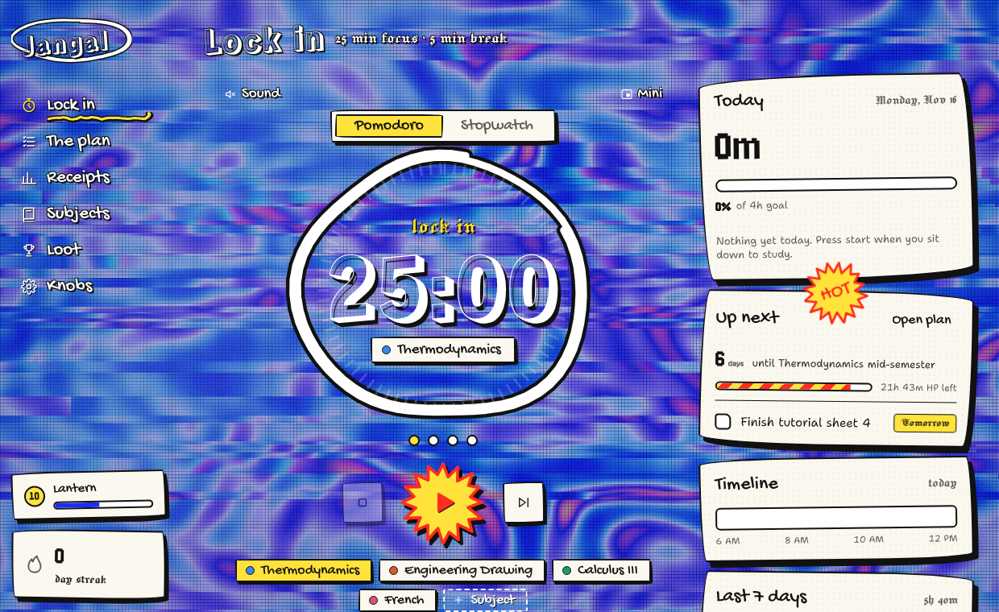

# Jangal



A desktop study timer for Windows that keeps you honest about how much you actually study. Everything is stored on your own laptop; there are no accounts and it works offline.

## Features

- **Focus timer**: Pomodoro or stopwatch, with a mini always-on-top timer.
- **Subjects**: tag every session, set a weekly hour target per subject.
- **Plan**: tasks with due dates, and exam countdowns that show on the Focus page.
- **Boss battles**: every exam is a boss with an HP bar; studying its subject wears it down before the day.
- **Insights**: calendar heatmap, daily and monthly charts, a year at a glance.
- **Rewards**: XP, levels and 24 badges earned from real study time.
- **Focus sounds**: rain, waves, deep hum or white noise while a session runs.
- **Themes**: Zine (the default: holographic screen, paper cut-outs, scribbled rings and sticker bursts), Midnight, Ember, Forest, Paper, Sky and Shinigami (black paper, brush lettering).
- **Final countdown**: a red ring and a heartbeat in the last 40 seconds of a focus session.
- **Your data**: daily automatic backups, JSON backup/restore, CSV export.

## Download

Grab the Windows installer (or the portable `.exe`) from the [Releases](../../releases) page.

Jangal was called Lumen before version 2.3. If you used Lumen, Jangal picks up your study history, settings and backups automatically the first time it opens.

## Run it from source

Requires [Node.js](https://nodejs.org/).

```bash
npm install
npm start
```

Build the Windows installer and portable app (output in `dist/`):

```bash
npm run dist
```

## Shortcuts

| Key | Action |
| --- | --- |
| Space | Start / pause |
| S | Skip phase |
| R | Stop and save |
| M | Mini timer |
| 1–6 | Switch page |

## Where your data lives

`%APPDATA%\Jangal\jangal-data.json`, with daily backups in `%APPDATA%\Jangal\backups` (the last 14 are kept).

## Project layout

```
main.js            Electron main process: window, saving, backups, notifications
preload.js         The small bridge between the window and the main process
renderer/
  index.html       Page structure
  styles.css       All styling, including the six classic themes
  zine/            The Zine theme: zine.css, zine.js (hand-drawn scribbles, theme wording) and holo.jpg
  fonts/           Caveat Brush, Rampart One, Gochi Hand, Jacquard 12, Jersey 10 and Shantell Sans,
                   all under the SIL Open Font License (licence files alongside)
  app.js           Timer engine, stats, subjects, settings
  plan.js          Tasks and exam countdowns
  rewards.js       XP, levels and badges
  ambient.js       Focus sounds (generated in the app, no audio files)
  icons.js         Icon set
```

## License

MIT
